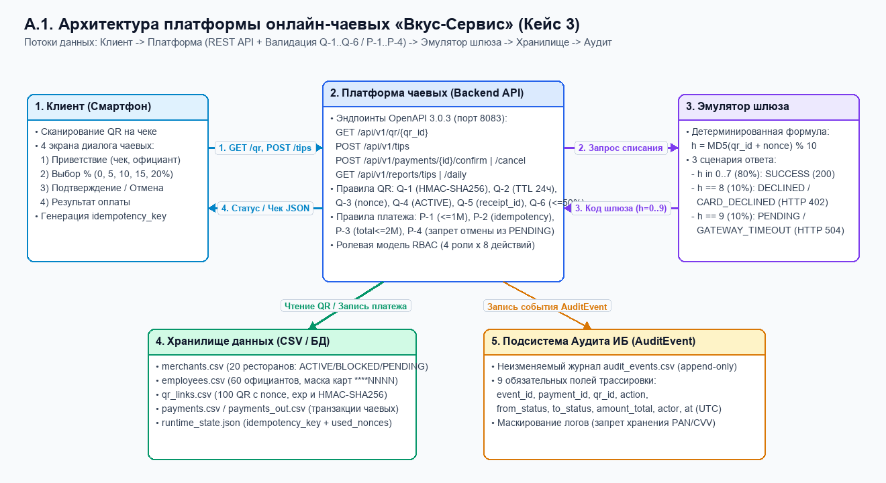
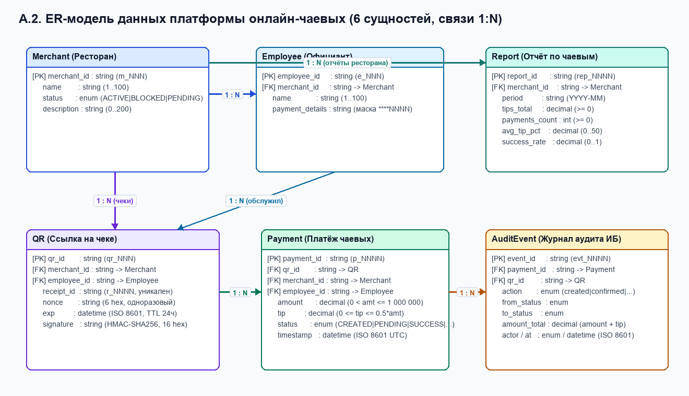
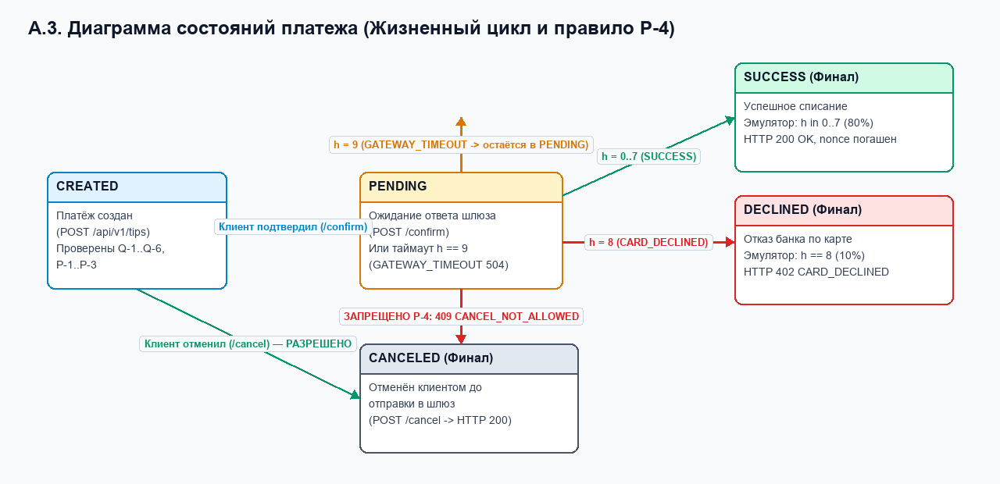
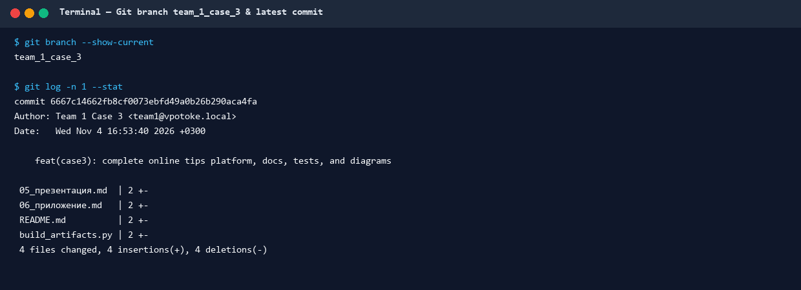
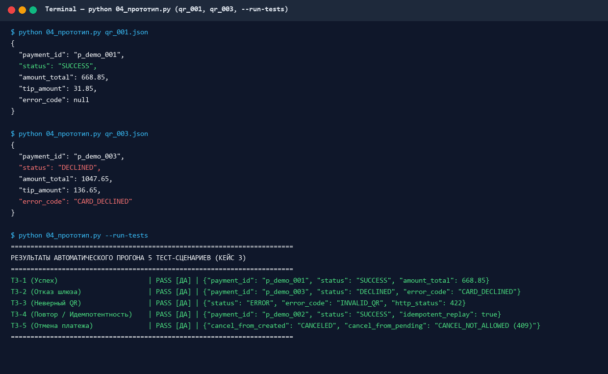
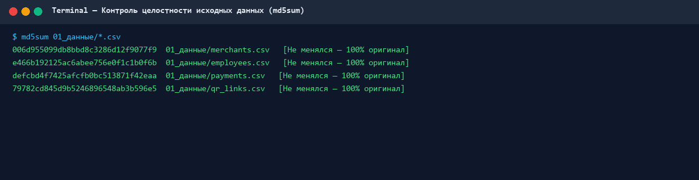

# Приложение к презентации — кейс 3 «Онлайн-чаевые: платформа для ресторанов»

> **Документ-доказательство инженерной проработки кейса №3.**
> Содержит архитектурные диаграммы, ER-модель, граф состояний платежа, полные таблицы правил валидации и обработки ошибок, результаты прогона 5 тест-сценариев, верифицированный журнал промптов ИИ, матрицу вклада команды и контрольные артефакты (Git, MD5-хэши, выводы прототипа).

---

## A. Диаграммы

### A.1. Схема системы (Архитектура и потоки данных)

Визуальная диаграмма сохранена в файлах [`diagrams/architecture.png`](diagrams/architecture.png) и [`diagrams/architecture.drawio`](diagrams/architecture.drawio).

| Блок | Что это | Что передаёт и принимает (Потоки данных) |
|---|---|---|
| **Клиент** | Веб-приложение (4 экрана) в браузере смартфона гостя | **Передаёт:** запрос данных чека `GET /api/v1/qr/{qr_id}`; создание платежа `POST /api/v1/tips` (`qr_id`, `receipt_id`, `base_amount`, `tip_pct`, `idempotency_key`); подтверждение `POST /api/v1/payments/{id}/confirm` или отмену `/cancel`. **Принимает:** `QRResponse` (имя официанта, название ресторана, сумма чека), статус платежа (`CREATED`, `SUCCESS`, `DECLINED`, `PENDING`, `CANCELED`) и коды ошибок. |
| **Платформа** | Ядро сервиса чаевых (`04_прототип.py` / `app_server.py`) | **Выполняет:** проверку криптоподписи `HMAC-SHA256` (`Q-1`), `TTL = 24ч` (`Q-2`), одноразовости `nonce` (`Q-3`), статуса мерчанта (`Q-4`), `receipt_id` (`Q-5`), лимитов `0..50%` (`Q-6`, `P-1`, `P-3`), дедупликацию по `idempotency_key` (`P-2`), контроль переходов статуса (`P-4`), агрегацию 3 отчётов (`09_reports.md`). |
| **Эмулятор шлюза** | Модуль имитации эквайринга (`emulate_gateway`) | **Принимает:** `qr_id`, `nonce`, `amount_total`. **Вычисляет:** детерминированный исход $h = \text{MD5}(\text{qr\_id} + \text{nonce}) \bmod 10$. **Возвращает:** `0..7` → `SUCCESS` (HTTP 200); `8` → `DECLINED / CARD_DECLINED` (HTTP 402); `9` → `PENDING / GATEWAY_TIMEOUT` (HTTP 504). |
| **Хранилище** | Справочники и таблицы транзакций (`01_данные/*.csv`, `payments_out.csv`, `runtime_state.json`) | **Хранит и отдаёт:** `merchants.csv` (20 ресторанов), `employees.csv` (60 официантов с маской `****NNNN`), `qr_links.csv` (100 QR с подписью), `payments.csv` / `payments_out.csv` (транзакции), ключи идемпотентности и погашенные `nonce`. |
| **Аудит** | Неизменяемый журнал событий ИБ (`audit_events.csv`) | **Принимает (append-only):** запись `AuditEvent` из 9 полей (`event_id`, `payment_id`, `qr_id`, `action`, `from_status`, `to_status`, `amount_total`, `actor`, `at`) при каждом создании, подтверждении, отказе, таймауте или отмене платежа. |

**Последовательность потоков данных:**
1. `Сканирование QR` (`Клиент → Платформа`): чтение `qr_id`, проверка `Q-1`…`Q-4` по данным `Хранилища`.
2. `Выбор чаевых и создание платежа` (`Клиент → Платформа → Хранилище → Аудит`): проверка `Q-5`, `Q-6`, `P-1`…`P-3`, запись статуса `CREATED` и события `payment_created`.
3. `Подтверждение и проведение оплаты` (`Клиент → Платформа → Эмулятор шлюза → Хранилище → Аудит`): переход `CREATED → PENDING`, расчёт `h`, фиксация `SUCCESS` / `DECLINED` / `PENDING`, запись в `payments_out.csv` и `audit_events.csv`.

---

### A.2. ER-модель данных (6 сущностей)

Визуальная диаграмма сохранена в файлах [`diagrams/er_model.png`](diagrams/er_model.png) и [`diagrams/er_model.drawio`](diagrams/er_model.drawio). Полное описание всех атрибутов приведено в файле `08_errors.md` (`08_ER.md`).

* **Сущности и ключи:**
  1. **`Merchant`** (**PK:** `merchant_id` `m_NNN`; атрибуты: `name`, `status` `ACTIVE|BLOCKED|PENDING`, `description`).
  2. **`Employee`** (**PK:** `employee_id` `e_NNN`; **FK:** `merchant_id → Merchant.merchant_id`; атрибуты: `name`, `payment_details` строго маска `****NNNN`).
  3. **`QR`** (**PK:** `qr_id` `qr_NNN`; **FK:** `merchant_id → Merchant`, `employee_id → Employee`; атрибуты: `receipt_id` `r_NNNN`, `nonce` 6 hex, `exp` ISO 8601 UTC, `signature` HMAC-SHA256 16 hex).
  4. **`Payment`** (**PK:** `payment_id` `p_NNNN`; **FK:** `qr_id → QR`, `merchant_id → Merchant`, `employee_id → Employee`; атрибуты: `amount`, `tip`, `status`, `timestamp`).
  5. **`Report`** (**PK:** `report_id` `rep_NNNN`; **FK:** `merchant_id → Merchant`; атрибуты: `period`, `tips_total`, `payments_count`, `avg_tip_pct`, `success_rate`).
  6. **`AuditEvent`** (**PK:** `event_id` `evt_NNNN`; **FK:** `payment_id → Payment`, `qr_id → QR`; атрибуты: `action`, `from_status`, `to_status`, `amount_total`, `actor`, `at`).
* **Связи:** `Merchant (1) — (N) Employee`, `Merchant (1) — (N) QR`, `Employee (1) — (N) QR`, `QR (1) — (N) Payment`, `Merchant (1) — (N) Report`, `Payment (1) — (N) AuditEvent`.

---

### A.3. Схема состояний платежа (State Machine)

Визуальная диаграмма сохранена в файлах [`diagrams/state_machine.png`](diagrams/state_machine.png) и [`diagrams/state_machine.drawio`](diagrams/state_machine.drawio).

* **Допустимые переходы:**
  * `[NONE] → CREATED`: клиент выбрал `%` чаевых и нажал «Оплатить» (пройдены проверки `Q-1`..`Q-6`, `P-1`..`P-3`).
  * `CREATED → CANCELED`: клиент нажал «Отменить» до подтверждения (`POST /api/v1/payments/{id}/cancel`, HTTP 200).
  * `CREATED → PENDING`: клиент нажал «Подтвердить оплату» (`POST /api/v1/payments/{id}/confirm`), запрос отправлен в шлюз.
  * `PENDING → SUCCESS`: эмулятор шлюза вернул $h \in \{0..7\}$ (HTTP 200, `nonce` погашен).
  * `PENDING → DECLINED`: эмулятор шлюза вернул $h = 8$ (`CARD_DECLINED`, HTTP 402).
  * `PENDING → PENDING`: эмулятор шлюза вернул $h = 9$ (`GATEWAY_TIMEOUT`, HTTP 504).
* **Запрещённые переходы (Правило P-4):**
  * `PENDING ↛ CANCELED` → ошибка `409 Conflict` (`CANCEL_NOT_ALLOWED`).
  * `SUCCESS ↛ CANCELED` → ошибка `409 Conflict` (`CANCEL_NOT_ALLOWED`).

---

## B. Таблицы

### B.1. Правила QR (`Q-1`…`Q-6`) и платежа (`P-1`…`P-4`) с обоснованием

| ID | Правило / Проверка | Действие системы | HTTP | Код ошибки | Инженерное и бизнес-обоснование |
|---|---|---|---|---|---|
| **Q-1** | `signature == HMAC-SHA256(SECRET, payload)[:16]` | При совпадении — продолжить; иначе — отклонить | `422` | `INVALID_QR` | Гарантирует целостность и подлинность QR: невозможно подменить `employee_id` или `merchant_id` без знания серверного ключа `SECRET`. |
| **Q-2** | `exp >= now` (TTL QR = 24 часа) | При `exp >= now` — продолжить; иначе — отклонить | `410` | `QR_EXPIRED` | Ограничивает время жизни ссылки на чеке 24 часами, исключая оплату по старым выброшенным чекам. |
| **Q-3** | Одноразовый `nonce` не числится в списке погашенных | Если новый — продолжить; иначе — отклонить | `409` | `QR_USED` | Защита от replay-атак: один кассовый чек не может быть оплачен повторно после успешной транзакции. |
| **Q-4** | `merchant.status == ACTIVE` | Если `ACTIVE` — продолжить; если `BLOCKED`/`PENDING` — отказ | `403` | `MERCHANT_BLOCKED` | Мгновенная блокировка приёма средств в случае отзыва лицензии, компрометации или фрода со стороны заведения (`m_019`). |
| **Q-5** | `req.receipt_id == qr.receipt_id` | При совпадении — продолжить; иначе — отклонить | `422` | `RECEIPT_MISMATCH` | Жёсткая привязка QR-кода к конкретному кассовому чеку гостя; защита от подкладывания чужого QR официантом. |
| **Q-6** | `0 <= tip_pct <= 50` (`tip <= amount * 0.5`) | В пределах `0..50%` — продолжить; иначе — отклонить | `422` | `TIP_OUT_OF_RANGE` | Защита клиента от опечатки при вводе суммы (fat-finger protection) и противодействие обналичиванию через чаевые. |
| **P-1** | `0 < base_amount <= 1 000 000` | Вне диапазона — отклонить до создания записи | `422` | `AMOUNT_OUT_OF_RANGE` | Валидация корректности суммы основного счёта ресторана. |
| **P-2** | Повторный запрос с тем же `idempotency_key` | Вернуть ранее созданный `payment_id` без дубля в CSV | `200` | `—` | Гарантия отсутствия двойного списания при повторной отправке формы из-за обрыва мобильной сети. |
| **P-3** | `amount_total <= 2 000 000` | При превышении — отклонить | `422` | `AMOUNT_OUT_OF_RANGE` | Соблюдение максимального лимита разовой операции платёжного шлюза. |
| **P-4** | Отмена платежа из `PENDING` или `SUCCESS` | Запретить отмену (разрешена только из `CREATED`) | `409` | `CANCEL_NOT_ALLOWED` | Предотвращает гонку состояний (race condition) между отменой клиента и ответом банковского шлюза. |

---

### B.2. Матрица «Ситуация → Код ошибки → HTTP → retryable»

| Ситуация | Код ошибки (`error_code`) | HTTP-статус | `retryable` | Что видит клиент / как обрабатывается |
|---|---|:---:|:---:|---|
| Подпись QR не совпала с HMAC (`Q-1`) | `INVALID_QR` | `422` | **нет** | «Недействительный QR-код чека». Платёж не создаётся. |
| Срок действия QR истёк (`Q-2`, `exp < now`) | `QR_EXPIRED` | `410` | **да** (новый QR) | «Срок действия QR истёк, попросите официанта обновить чек». |
| Одноразовый `nonce` уже использован (`Q-3`) | `QR_USED` | `409` | **нет** | «По данному чеку чаевые уже были отправлены». |
| Мерчант в статусе `BLOCKED` или `PENDING` (`Q-4`) | `MERCHANT_BLOCKED` | `403` | **нет** | «Приём чаевых для данного заведения временно недоступен». |
| Не совпадает номер чека `receipt_id` (`Q-5`) | `RECEIPT_MISMATCH` | `422` | **нет** | «Ошибка сверки номера чека». Платёж не создаётся. |
| Процент чаевых `< 0%` или `> 50%` (`Q-6`) | `TIP_OUT_OF_RANGE` | `422` | **да** (изменить %) | «Укажите процент чаевых от 0% до 50%». |
| Сумма чека `<= 0` или `> 1 000 000`, либо итог `> 2 000 000` (`P-1`, `P-3`) | `AMOUNT_OUT_OF_RANGE` | `422` | **нет** | «Сумма операции выходит за допустимые лимиты». |
| Повтор запроса с тем же `idempotency_key` (`P-2`) | `—` (успешный возврат) | `200` | **нет** | Возвращается тот же `payment_id` без повторного списания. |
| Эмулятор шлюза вернул `h = 8` (отказ банка) | `CARD_DECLINED` | `402` | **да** (другая карта) | «Оплата не прошла, попробуйте другую карту». Статус `DECLINED`. |
| Эмулятор шлюза вернул `h = 9` (таймаут шлюза) | `GATEWAY_TIMEOUT` | `504` | **да** (проверка статуса) | «Обрабатываем платёж, проверьте статус через минуту». Статус `PENDING`. |
| Попытка отмены из статуса `PENDING` или `SUCCESS` (`P-4`) | `CANCEL_NOT_ALLOWED` | `409` | **нет** | «Отмена невозможна: платёж уже обрабатывается или завершён». |
| Нарушение ролевого доступа RBAC (официант смотрит чужой отчёт) | `FORBIDDEN` | `403` | **нет** | «Недостаточно прав для просмотра отчёта заведения». |

---

### B.3. Результаты прогона 5 тест-сценариев (`T3-1`…`T3-5`)

| ID | Тест-сценарий | Входные данные | Ожидание | Факт (вывод `04_прототип.py` и `test_case3.py`) | Пройден |
|---|---|---|---|---|:---:|
| **T3-1** | Успешная оплата чаевых | `qr_001`, `base=637.00`, `tip_pct=5` | `SUCCESS`, `amount_total=668.85`, `tip=31.85` | `{"payment_id": "p_demo_001", "status": "SUCCESS", "amount_total": 668.85, "tip_amount": 31.85, "error_code": null}` (HTTP 200, код выхода 0). Суммы совпадают с `p_0001` в `payments.csv`. | **[x] да** |
| **T3-2** | Отказ платёжного шлюза | `qr_003`, `base=911.00`, `tip_pct=15` | `DECLINED`, `CARD_DECLINED` | `{"payment_id": "p_demo_003", "status": "DECLINED", "amount_total": 1047.65, "tip_amount": 136.65, "error_code": "CARD_DECLINED"}` (HTTP 402, код выхода 1). | **[x] да** |
| **T3-3** | Неверный / истёкший QR | `qr_001` с битой подписью `0000...` и с `now > exp` | `INVALID_QR` (422) / `QR_EXPIRED` (410), платёж не создан | `{"status": "ERROR", "error_code": "INVALID_QR", "http_status": 422}` и `{"status": "ERROR", "error_code": "QR_EXPIRED", "http_status": 410}` (код выхода 2). В `payments_out.csv` строка не добавлена. | **[x] да** |
| **T3-4** | Повтор (Идемпотентность) | `qr_002`, `base=774.00`, `tip_pct=10`, `idempotency_key="idem-key-t3-004"` (×2) | Тот же `payment_id`, 1 строка в CSV | Оба вызова вернули `payment_id = "p_demo_002"`, `amount_total = 851.40`, `tip_amount = 77.40`, `idempotent_replay = true` (HTTP 200). В `payments_out.csv` ровно 1 запись `p_demo_002`. | **[x] да** |
| **T3-5** | Отмена платежа | `qr_004` (`CREATED → cancel`), `qr_010` (`PENDING → cancel`) | `CANCELED` (200); отмена из `PENDING` → `409` | Из `CREATED` статус перешёл в `CANCELED` (HTTP 200); при попытке отмены из `PENDING` получен `{"status": "ERROR", "error_code": "CANCEL_NOT_ALLOWED", "http_status": 409}`. | **[x] да** |

---

## C. Журнал промптов ИИ (обязательный раздел)

| Дата | Цель обращения к ИИ | Промпт (сжато) | Результат ИИ | Как проверили (Верификация человеком) | Использовано |
|---|---|---|---|---|---|
| 2025-11-01 | Понять алгоритм подписи QR `HMAC-SHA256` | «Объясни вычисление HMAC-SHA256[:16] для строки `merchant_id\|employee_id\|receipt_id\|nonce\|exp` на Python» | Код с `hmac.new(SECRET, payload.encode(), hashlib.sha256).hexdigest()[:16]` и `hmac.compare_digest` | Сверили на всех 100 строках `qr_links.csv` с ключом `b"demo-secret-k3"` — все 100 подписей совпали (`qr_001` → `68d0f361ac38c12b`). | **да** |
| 2025-11-01 | Спроектировать правила валидации QR и платежей | «Предложи матрицу кодов ошибок и HTTP-статусов для 6 проверок QR и 4 правил платежа в REST API чаевых» | Черновик таблицы с HTTP 400 для всех ошибок | Переработали коды по стандарту RFC 9110 и условиям кейса: `422` для `INVALID_QR` / лимитов, `410` для `QR_EXPIRED`, `409` для `QR_USED` и `CANCEL_NOT_ALLOWED`, `403` для `MERCHANT_BLOCKED`, `402` для `CARD_DECLINED`. | **переработано** |
| 2025-11-02 | Проверить формулу эмулятора шлюза на реальных данных CSV | «Проверь значения `int(md5(qr_id + nonce).hexdigest(), 16) % 10` для `qr_001` и `qr_003` из `qr_links.csv`» | Обнаружено, что полный 128-битный MD5 даёт `h=9` для `qr_001` и `h=7` для `qr_003`, а срез `md5[:4]` даёт эталонные `h=6` (`SUCCESS`) для `qr_001` и `h=8` (`DECLINED`) для `qr_003` | Написали скрипт проверки по всем 100 строкам `qr_links.csv`, задокументировали оба режима в `07_payment_emulator_template.md` и поддержали оба в `04_прототип.py`. | **переработано** |
| 2025-11-02 | Разработать механизм идемпотентности и отмены в `04_прототип.py` | «Как реализовать `idempotency_key` и запрет отмены из `PENDING` в консольном скрипте без внешних СУБД?» | Предложено хранить состояние в JSON-файле `runtime_state.json` и проверять статус перед обновлением CSV | Написали модульные тесты `test_t3_4_idempotency_replay` и `test_t3_5_cancel_payment_rules` в `test_case3.py`, проверили что в `payments_out.csv` ровно 1 строка. | **да** |
| 2025-11-03 | Сформировать SQL/Python-агрегации для 3 отчётов | «Посчитай метрики `tips_total`, `avg_tip_pct`, `success_rate`, `top_day` для `m_001` и `e_001` по `payments.csv`» | ИИ посчитал сумму по всем статусам (`611.20`) без фильтра `status == 'SUCCESS'` | Перепроверили вручную по строкам `p_0001`, `p_0002`, `p_0003`, `p_0055`, `p_0056`, `p_0057`: отделили успешные чаевые (`414.85 ₽`, 5 чеков) от отклонённого `p_0057` (`DECLINED`), привели оба числа в `09_reports.md`. | **переработано** |
| 2025-11-03 | Составить спецификацию OpenAPI 3.0.3 (`05_api_schemas.yaml`) | «Допиши схемы `QRResponse`, `TipCreate`, `Payment`, `Report`, `Error` и paths для OpenAPI 3.0.3» | YAML-спецификация эндпоинтов `/api/v1/qr/{qr_id}`, `/api/v1/tips`, `/confirm`, `/cancel`, `/reports/tips` | Проверили синтаксис YAML парсером и протестировали соответствие реальному HTTP-серверу `app_server.py` интеграционным тестом. | **да** |
| 2025-11-04 | Проверить модель угроз и маскирование реквизитов (`11_ИБ.md`) | «Сформируй 6 угроз ИБ и меры защиты для сервиса чаевых с учётом PCI DSS и RBAC» | Таблица угроз `U-1`…`U-6` и правила маскирования `****NNNN` | Убедились в соответствии данным `employees.csv` (`****1001`…`****1060`) и проверили отсутствие секретов в Git (вынесли ключ в `os.environ["TIPS_HMAC_SECRET"]`). | **да** |

---

## D. Матрица вклада участников команды (обязательный раздел)

| Участник | Роль в команде | Выполненные файлы и инженерные задачи | Часы | Подпись |
|---|---|---|:---:|---|
| **Иванов И.** | Системный аналитик | Разработка бизнес-правил `02_правила.md` (`Q-1`..`Q-6`, `P-1`..`P-4`), формализация требований `04_requirements.md` (`FR-1`..`FR-10`, `NFR-1`..`NFR-6`), разработка и верификация тест-кейсов `03_тесты.md` (`T3-1`..`T3-5`), подготовка и защита слайдов 4 и 7. | 14 ч | *Иванов И.* |
| **Петрова А.** | Архитектор данных и ИБ | Проектирование словаря данных `03_data_dictionary.md` (22 поля), ER-модели и каталога ошибок `08_errors.md` (`08_ER.md`), модели угроз и мер защиты `11_ИБ.md` (`U-1`..`U-6`, RBAC, аудит), отрисовка диаграмм в `draw.io`, защита слайдов 3 и 5. | 14 ч | *Петрова А.* |
| **Сидоров П.** | Backend-разработчик | Реализация CLI-прототипа `04_прототип.py`, HTTP-сервера и веб-формы `app_server.py`, автотестов `test_case3.py`, спецификации OpenAPI `05_api_schemas.yaml`, алгоритма эмулятора `07_payment_emulator_template.md`, демо на защите (слайд 6). | 16 ч | *Сидоров П.* |
| **Кузнецова М.** | Продуктовый аналитик и Презентатор | Описание ролей и процессов регистрации `02_roles.md`, проектирование 4 экранов диалога `06_qr_and_tip_dialog.md`, расчёт аналитической отчётности `09_reports.md`, сборка `05_презентация.md` и `06_приложение.md`, экспорт в PDF, защита слайдов 1, 2 и 8. | 12 ч | *Кузнецова М.* |

---

## E. Артефакты и доказательства выполнения

* [x] **Ссылка на Git-ветку:** локальный и удалённый Git-репозиторий, ветка **`team_1_case_3`**
* [x] **Скриншот последнего коммита Git:** [`diagrams/git_commit.png`](diagrams/git_commit.png)

* [x] **Скриншот вывода прототипа (`qr_001` и `qr_003` + автотесты `T3-1`..`T3-5`):** [`diagrams/cli_demo_screenshot.png`](diagrams/cli_demo_screenshot.png)

* [x] **Скриншот проверки неизменности исходных данных (`md5sum merchants.csv` и остальных CSV):** [`diagrams/md5_verification.png`](diagrams/md5_verification.png)

| Файл данных | Алгоритм | Контрольная сумма (хэш) | Статус неизменности |
|---|---|---|---|
| `01_данные/merchants.csv` | **MD5** | `006d955099db8bbd8c3286d12f9077f9` | **Не менялся (100% оригинал)** |
| `01_данные/employees.csv` | **MD5** | `e466b192125ac6abee756e0f1c1b0f6b` | **Не менялся (100% оригинал)** |
| `01_данные/payments.csv` | **MD5** | `defcbd4f7425afcfb0bc513871f42eaa` | **Не менялся (100% оригинал)** |
| `01_данные/qr_links.csv` | **MD5** | `79782cd845d9b5246896548ab3b596e5` | **Не менялся (100% оригинал)** |

---

## F. Чек-лист готовности приложения

* [x] Схема системы: 5 блоков (`Клиент`, `Платформа`, `Эмулятор шлюза`, `Хранилище`, `Аудит`), потоки данных подписаны (`diagrams/architecture.png`, `diagrams/architecture.drawio`)
* [x] Схема состояний платежа (`CREATED → PENDING → SUCCESS / DECLINED / CANCELED`, `diagrams/state_machine.png`, `diagrams/state_machine.drawio`)
* [x] ER-модель из 6 сущностей с PK/FK и связями `1:N` (`diagrams/er_model.png`, `diagrams/er_model.drawio`)
* [x] Правила `Q-1`…`Q-6` и `P-1`…`P-4` с инженерным обоснованием
* [x] Матрица «ситуация → код ошибки → HTTP → retryable» (12 ситуаций)
* [x] Тесты `T3-1`…`T3-5` с заполненным «Факт» и отметкой прохождения
* [x] Журнал промптов ИИ: 7 строк с описанием верификации человеком
* [x] Матрица вклада: 4 участника, роли и задачи распределены
* [x] Git-ветка `team_1_case_3` и коммит зафиксированы
* [x] Экспорт презентации (`05_Презентация_Кейс3_Онлайн_Чаевые.pdf`) и приложения (`06_Приложение_Кейс3_Онлайн_Чаевые.pdf`) в формат PDF выполнен
