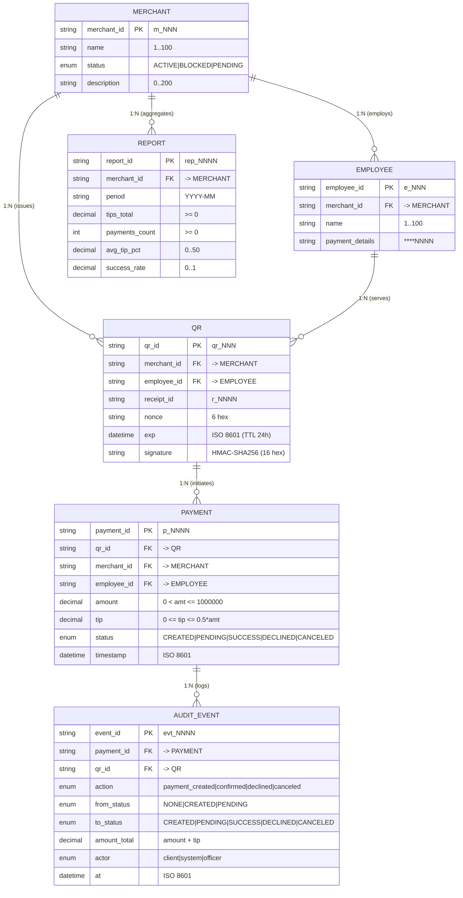

# ER-модель и справочник кодов ошибок — кейс 3 «Онлайн-чаевые»

> **Примечание:** данный файл объединяет полную **ER-модель данных (6 сущностей)** и **Единый каталог кодов ошибок (`08_errors.md` / `08_ER.md`)**, на который ссылаются `03_data_dictionary.md` и `06_приложение.md`.

---

## 1. Сущности (6 сущностей)

| Сущность | Что хранит | Зачем нужна в системе |
|---|---|---|
| `Merchant` | `merchant_id`, `name`, `status`, `description` | Справочник подключённых ресторанов сети «Вкус-Сервис» и контроль их статуса (`ACTIVE`/`BLOCKED`/`PENDING`). |
| `Employee` | `employee_id`, `merchant_id`, `name`, `payment_details` | Справочник официантов с привязкой к конкретному ресторану и маскированными реквизитами выплат (`****NNNN`). |
| `QR` | `qr_id`, `merchant_id`, `employee_id`, `receipt_id`, `nonce`, `exp`, `signature` | Одноразовая платёжная ссылка, привязанная к кассовому чеку, официанту и защищённая криптоподписью `HMAC-SHA256`. |
| `Payment` | `payment_id`, `qr_id`, `merchant_id`, `employee_id`, `amount`, `tip`, `status`, `timestamp`, `idempotency_key` | Факт операции оплаты чаевых клиентом (базовая сумма чека, сумма чаевых, текущий статус жизненного цикла). |
| `Report` | `report_id`, `merchant_id`, `period`, `tips_total`, `payments_count`, `avg_tip_pct`, `success_rate` | Агрегированные аналитические показатели по чаевым за период (по мерчанту, официанту и дням). |
| `AuditEvent` | `event_id`, `payment_id`, `qr_id`, `action`, `from_status`, `to_status`, `amount_total`, `actor`, `at` | Неизменяемый журнал событий информационной безопасности и переходов статусов для расследования инцидентов и сверки. |

---

## 2. Атрибуты сущностей (PK/FK, типы, обязательность, ограничения)

### 2.1. Merchant (ОБРАЗЕЦ — не трогать)

|Поле|Тип|PK/FK|Обяз.|Ограничение|
|-|-|-|-|-|
|merchant\_id|string|**PK**|да|`m_NNN` (`^m_[0-9]{3}$`)|
|name|string|—|да|1–100 символов|
|status|enum|—|да|`ACTIVE`/`BLOCKED`/`PENDING`|
|description|string|—|нет|0–200 символов|

### 2.2. Employee (сотрудник / официант)

| Поле | Тип | PK/FK | Обяз. | Ограничение |
|---|---|---|---|---|
| `employee_id` | string | **PK** | да | Формат `e_NNN` (`^e_[0-9]{3}$`, `e_001`…`e_060`) |
| `merchant_id` | string | **FK** → `Merchant.merchant_id` | да | Формат `m_NNN` (`^m_[0-9]{3}$`), существующий мерчант |
| `name` | string | — | да | 1–100 символов (ФИО / имя с инициалами, напр. `Иванов И.`) |
| `payment_details` | string | — | да | Строго маска `****NNNN` (`^\*{4}[0-9]{4}$`), открытый PAN запрещён |

### 2.3. QR (платёжная ссылка на чеке)

| Поле | Тип | PK/FK | Обяз. | Ограничение |
|---|---|---|---|---|
| `qr_id` | string | **PK** | да | Формат `qr_NNN` (`^qr_[0-9]{3}$`, `qr_001`…`qr_100`) |
| `merchant_id` | string | **FK** → `Merchant.merchant_id` | да | Формат `m_NNN`, `Merchant.status == ACTIVE` |
| `employee_id` | string | **FK** → `Employee.employee_id` | да | Формат `e_NNN`, принадлежит данному `merchant_id` |
| `receipt_id` | string | — | да | Формат `r_NNNN` (`^r_[0-9]{4}$`), уникален в рамках `merchant_id` |
| `nonce` | string | — | да | 6 hex-символов (`^[a-f0-9]{6}$`), одноразовый токен (anti-replay) |
| `exp` | datetime | — | да | ISO 8601 UTC (`YYYY-MM-DDTHH:MM:SSZ`), `TTL = 24 ч` от генерации |
| `signature` | string | — | да | 16 hex-символов (`^[a-f0-9]{16}$`), `HMAC-SHA256(SECRET, payload)[:16]` |

### 2.4. Payment (транзакция оплаты чаевых)

| Поле | Тип | PK/FK | Обяз. | Ограничение |
|---|---|---|---|---|
| `payment_id` | string | **PK** | да | Формат `p_NNNN` (`^p_[0-9]{4,}$`) |
| `qr_id` | string | **FK** → `QR.qr_id` | да | Формат `qr_NNN` (`^qr_[0-9]{3}$`) |
| `merchant_id` | string | **FK** → `Merchant.merchant_id` | да | Формат `m_NNN` (`^m_[0-9]{3}$`) |
| `employee_id` | string | **FK** → `Employee.employee_id` | да | Формат `e_NNN` (`^e_[0-9]{3}$`) |
| `amount` | decimal(10,2) | — | да | `> 0`, `<= 1 000 000.00` (базовая сумма чека) |
| `tip` | decimal(10,2) | — | да | `>= 0`, `<= amount * 0.5` (`tip_pct` от 0% до 50%) |
| `status` | enum | — | да | `CREATED` / `PENDING` / `SUCCESS` / `DECLINED` / `CANCELED` |
| `timestamp` | datetime | — | да | ISO 8601 UTC (`YYYY-MM-DDTHH:MM:SSZ`) |

### 2.5. Report (агрегированный отчёт)

| Поле | Тип | PK/FK | Обяз. | Ограничение |
|---|---|---|---|---|
| `report_id` | string | **PK** | да | Формат `rep_NNNN` (`^rep_[0-9]{4}$`) |
| `merchant_id` | string | **FK** → `Merchant.merchant_id` | да | Формат `m_NNN` (`^m_[0-9]{3}$`) |
| `period` | string | — | да | Формат `YYYY-MM` (например, `2025-11`) или `YYYY-MM-DD` |
| `tips_total` | decimal(12,2) | — | да | `>= 0.00` (сумма чаевых за период) |
| `payments_count` | integer | — | да | `>= 0` (количество платежей за период) |
| `avg_tip_pct` | decimal(5,2) | — | да | `0.00`…`50.00` (средний процент чаевых) |
| `success_rate` | decimal(5,4) | — | да | `0.0000`…`1.0000` (`count(SUCCESS) / count(*)`) |

### 2.6. AuditEvent (событие журнала аудита)

| Поле | Тип | PK/FK | Обяз. | Ограничение |
|---|---|---|---|---|
| `event_id` | string | **PK** | да | Формат `evt_NNNN` (`^evt_[0-9]{4,}$`) |
| `payment_id` | string | **FK** → `Payment.payment_id` | да | Формат `p_NNNN` |
| `qr_id` | string | **FK** → `QR.qr_id` | да | Формат `qr_NNN` |
| `action` | enum | — | да | `payment_created` / `payment_confirmed` / `payment_declined` / `payment_timeout` / `payment_canceled` |
| `from_status` | enum | — | да | `NONE` / `CREATED` / `PENDING` / `SUCCESS` / `DECLINED` / `CANCELED` |
| `to_status` | enum | — | да | `CREATED` / `PENDING` / `SUCCESS` / `DECLINED` / `CANCELED` |
| `amount_total` | decimal(10,2) | — | да | `> 0`, `<= 2 000 000.00` (`amount + tip`) |
| `actor` | enum | — | да | `system` / `client` / `officer` / `admin` |
| `at` | datetime | — | да | ISO 8601 UTC (`YYYY-MM-DDTHH:MM:SSZ`) |

---

## 3. Связи между сущностями

| Связь | Тип (Кардинальность) | Обоснование бизнес-логики |
|---|---|---|
| `Merchant → Employee` | **1 : N** | В одном ресторане (`Merchant`) работает несколько официантов (`Employee`, например `e_001`..`e_003` в `m_001`), каждый официант привязан к одному заведению. |
| `Merchant → QR` | **1 : N** | Один ресторан (`Merchant`) выпускает множество чеков с уникальными QR-кодами (`QR`). |
| `Employee → QR` | **1 : N** | Один официант (`Employee`) обслуживает множество столов/чеков, для каждого генерируется свой `QR`. |
| `QR → Payment` | **1 : N** | По одному QR-коду может быть создано несколько попыток платежа (например, первая попытка отменена `CANCELED` или отклонена банком `DECLINED`, а вторая — успешна `SUCCESS`), но не более одного `SUCCESS` за счёт погашения `nonce`. |
| `Merchant → Report` | **1 : N** | Для одного мерчанта формируется множество отчётов за различные периоды (`YYYY-MM`, посуточные срезы). |
| `Payment → AuditEvent` | **1 : N** | За время жизни одного платежа происходит несколько переходов состояния (`NONE → CREATED`, `CREATED → PENDING`, `PENDING → SUCCESS/DECLINED`, `CREATED → CANCELED`), каждый из которых порождает отдельную запись `AuditEvent`. |

---

## 4. Диаграмма ER-модели (Mermaid + PNG в `diagrams/er_model.png` и `diagrams/er_model.drawio`)

---

## 5. Единый справочник кодов ошибок (`08_errors.md`)

| Код ошибки (`error_code`) | Правило | HTTP-статус | `retryable` | Описание и причина возникновения |
|---|---|---|---|---|
| `INVALID_QR` | `Q-1` | `422 Unprocessable Entity` | `нет` | Не совпала криптографическая подпись `HMAC-SHA256` или `qr_id` не существует / нарушена целостность данных QR. |
| `QR_EXPIRED` | `Q-2` | `410 Gone` | `да` (новый QR) | Истёк срок жизни QR-кода (`exp < now`, TTL превышает 24 часа). |
| `QR_USED` | `Q-3` | `409 Conflict` | `нет` | Одноразовый токен `nonce` уже был использован в успешном платеже (защита от replay-атак). |
| `MERCHANT_BLOCKED` | `Q-4` | `403 Forbidden` | `нет` | Мерчант находится в статусе `BLOCKED` (например, `m_019`) или ещё не активирован (`PENDING`, `m_020`). |
| `RECEIPT_MISMATCH` | `Q-5` | `422 Unprocessable Entity` | `нет` | Переданный `receipt_id` не совпадает с `receipt_id`, привязанным к данному `qr_id`. |
| `TIP_OUT_OF_RANGE` | `Q-6` | `422 Unprocessable Entity` | `да` (изменить %) | Процент чаевых `tip_pct` меньше `0%` или превышает `50%` (`tip > amount * 0.5`). |
| `AMOUNT_OUT_OF_RANGE` | `P-1`, `P-3` | `422 Unprocessable Entity` | `нет` | Базовая сумма чека `base_amount <= 0` или `> 1 000 000`, либо итоговая сумма `amount_total > 2 000 000`. |
| `CARD_DECLINED` | Эмулятор (`h=8`) | `402 Payment Required` | `да` (другая карта) | Платёжный шлюз отклонил списание по карте клиента (статус платежа переходит в `DECLINED`). |
| `GATEWAY_TIMEOUT` | Эмулятор (`h=9`) | `504 Gateway Timeout` | `да` (опрос статуса) | Платёжный шлюз не ответил вовремя; платёж остаётся в статусе `PENDING`. |
| `CANCEL_NOT_ALLOWED` | `P-4` | `409 Conflict` | `нет` | Попытка отменить платёж, который уже находится в статусе `PENDING`, `SUCCESS` или `DECLINED`. |
| `INVALID_PAYMENT_DETAILS` | Регистрация | `422 Unprocessable Entity` | `да` | Попытка сохранить немаскированные реквизиты сотрудника (требуется формат `****NNNN`). |
| `FORBIDDEN` | RBAC | `403 Forbidden` | `нет` | Роль пользователя не имеет прав на запрашиваемую операцию (например, официант запрашивает отчёт по всему заведению). |

---

## 6. Критерий приёмки

* [x] 6 сущностей описаны (`Merchant`, `Employee`, `QR`, `Payment`, `Report`, `AuditEvent`)
* [x] Для каждой сущности указаны PK/FK, типы и ограничения
* [x] Связи описаны с типом (`1:N`) и обоснованием
* [x] `payment_details` — только маска `****NNNN`
* [x] `signature` — `HMAC-SHA256`, не plain hash
* [x] Диаграмма в draw.io (`diagrams/er_model.drawio`) и PNG (`diagrams/er_model.png`) с PK/FK и связями
